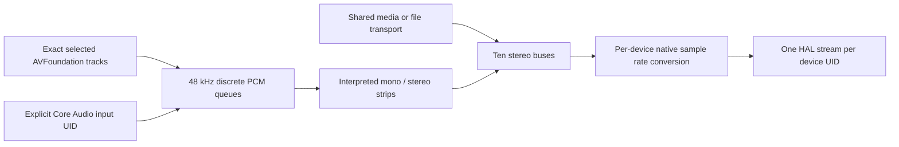

# Audio engine development

Branch feature/audio-engine, from f51e1b8. Existing tags and main remain unchanged. Planned order is audio, slides, playback queues, then UI overhaul; this branch does not implement slides/queues.

## Stage 1 — startup viewport recall (November 2, 2026)

The user reports that corner pinning appears to work, imported videos resume and the camera reconnects on launch. Those are scoped observations, not general continuity acceptance.

Two real defects were corrected without replacing recovery: final shutdown reused the previous periodic output set (a recent enable/disable could be missed); and unsaved sessions had no persistent destination namespace. Shutdown now captures logical activation and native geometry before consumer retirement. Unsaved destinations are scoped by machine + persistent project identity + an explicit unsaved-session discriminator, separately from saved project paths. Existing missing/ambiguous/conflicting destination resolution and Disable All Outputs remain.

The real installed profile originally remembered no enabled outputs. A private backup was made outside the repository. Restore Last Session and Restore enabled outputs are now enabled as requested; existing logical Left/Right were explicitly activated, Left windowed and Right assigned to the attached Crestron display. No scene/layer/viewport geometry was replaced.

On Apple M1 Pro/macOS 15.5, normal Command-Q (PID 9350) retained both enabled definitions and exact Right display UUID. Actual Launchpad search/tile click relaunched the installed executable without arguments (PID 9706, parent launchd). Native window enumeration asserted identical before/after bounds: Left x20 y542 w960 h568, Right x1800 y0 w1920 h1080 in Quartz screen coordinates; the operator bounds also matched. Document equality and two enabled outputs were asserted after restoration. Windowed geometry remains in AppKit points in recovery; fullscreen covers NSScreen's exact assigned frame (AppKit y89 here). These are native placement assertions, not physical picture/scanout synchronization checks.

Audio activation will remain separate from this video-output preference. Existing operator/capture-conditioned pause limitations and wider hardware acceptance remain pending.

## Audio implementation

The `rastera-audio` crate contains platform-independent 48 kHz Float32 mixing, model/validation, channel interpretation, DSP, bounded SPSC queues and sample-position transport. Desktop owns operators, file workers and machine patches. `native/audio.mm` is the narrow Core Audio / AVFoundation adapter. Slides and cue queues remain future work; producer/submix traits and bounded generation-scoped scheduled gain commands are reusable interfaces, not fake slide/cue engines.



A source strip has input trim, high-pass, four RBJ parametric bands, linked compressor, fader/mute, and ten post-source-fader sends (`0 = Off`). Mono pan is equal power, −3 dB at center; stereo preserves channel order. The compressor exposes threshold dBFS, ratio, attack/release ms, knee and makeup dB, bypass and reset. Ten persistent named stereo buses have the same DSP and an independently enabled sample-peak limiter. The limiter is not a true-peak/oversampled limiter. Physical pairs shared by buses are explicitly summed in the same device stream; final device samples are clamped to ±1. Bus meters precede physical summing. Clipping indication latches; meters distinguish source input/output and gain reduction.

Source trim/fader/mute/sends/pan and DSP changes are smoothed. Interpretation remaps are installed between 128-frame blocks and crossfade old/new strip processing for 480 samples (10 ms). Invalid parameters/graphs keep the last valid graph. Non-finite input becomes zero; values and internal filter state are bounded. Stable strip IDs are independent of visual placement and output-device assignment.

### Channels, identity and scene participation

Two exposed channels default to Stereo (1/2), with Dual Mono available. Four default to Dual Stereo (1/2, 3/4), with Quad Mono available. Mono is supported too. One strip is created per pair or mono channel, each with independent DSP, mute/pan and sends. Selected channels retain exact track IDs and zero-based native channel indices; UI mappings are labelled one-based and can be reordered. The track selector shows language, rate, channel count and start time. It selects only the first track by default; combining multiple tracks is an explicit action, never an automatic alternate-language mix.

AVAssetReaderTrackOutput requests 48 kHz little-endian interleaved Float32 without a channel-count or layout override. Every required track is decoded once per playback source; separate tracks retain their own timestamps/edit offsets. Channel interpretation does not restart the video. An exact previous mapping restores its dormant strip ID/settings; newly needed mappings inherit compatible settings, otherwise defaults. Up to 16 dormant mappings per source are retained. Unavailable requested channels remain in the document, become silent and report their status.

Visual duplicates share their playback/capture identity and contribute once. A separately imported playback has its own transport. Active-scene references include backgrounds; crop, pin, opacity, visibility and locking do not alter audio gain. Standalone audio files/inputs have explicit scene memberships; Always On overrides scene participation. Duplicating a scene copies memberships. Removing the last picture does not discard a source retained by its audio definition. Explicit source/audio mute is separate from picture properties.

Capture input uses the exact Core Audio UID/channel selection exposed by macOS. A separately exposed input can be explicitly linked to a picture capture source; no unrelated default microphone is inferred. Devices absent from Core Audio or unsupported virtual formats report unavailable rather than pretending to receive embedded audio. The native AVPlayer remains muted/volume zero: decoded PCM has no parallel direct-monitor path.

### Timing and resource ownership

There are four independent activities: control/preparation, per-source decode/transport workers, one mixer worker, and HAL callbacks. No audio clock comes from egui repaint or GPU presentation. File-video audio follows the same AVPlayer item's Core Media timebase/host anchors as its picture; anchors are sampled before pixel copying. File-only playback has a separate single-writer transport actor, retained across DSP/channel changes. Play/pause/stop/restart/seek and generation-scoped scheduled gain use integer 48 kHz sample positions. File-only actual playheads are stored separately in recovery, not written into the editable document every tick.

A graph applies between 128-frame blocks (2.667 ms). Current prefill is **80 ms**: the initial 40 ms run recorded device underruns/late blocks, whereas subsequent 15-second runs with 80 ms recorded zero new device underruns and late blocks. File samples are projected to the scheduled output host time, not simply delayed by prefill. Live input uses an explicit **120 ms base software delay** (80 ms prefill plus 40 ms capture margin), plus the selected sync offset and native conversion/device latency. Live offset is −20…500 ms; file offset is −500…500 ms; positive values delay audio. These are software timing relationships, not measured physical lip sync.

Per-device AudioConverter performs nominal rate conversion off the HAL callback, with high-quality filtering, bounded scratch and retained stream state on temporary starvation. Core Audio output host/sample timestamps select frames and follow independent device clocks with bounded interpolation rather than requiring an aggregate/default-output change. Converter read-ahead, device buffer/latency, missing/zero timestamps, actual HAL content/peak, clock-rate estimates and queue counters are recorded. Unknown timestamps remain unknown; callback arrival is not labelled DAC presentation. High-pass/EQ add frequency-dependent phase; compressor/limiter have no lookahead buffer. Physical DAC/ADC, display and acoustic latency still need loopback measurement/calibration.

Limits: 16 sources, 64 active strips, 10 stereo buses, 12 simultaneous device streams, 32 native device/track channels (at most four explicitly selected channels per source), 64 PCM packets ×128 frames per required track, and 8192-frame native input/output rings. UI→control and control→renderer queues each hold one pending complete state; retirement is bounded. Input history holds 32768 frames per live device. Decoder backpressure waits outside the mixer/HAL callback. Queue starvation emits silence; overrun drops new frames and increments counters; seeks/restarts invalidate obsolete generations. Pause/end fade to silence even with a held picture. Natural file/video loops currently use seek/generation transitions; source-PCM gaps around these transitions are counted and are **not claimed seamless**.

HAL callbacks perform bounded buffer arithmetic/ring operations and lock-free telemetry only: no allocation/free, blocking locks, logging, file/device discovery or graph destruction. File/decoder/device preparation is on control/decode owners. Old graphs, queues, workers and devices are returned to control after the renderer releases them. A device is retired before another stream for the same UID is opened. Disconnect/rate/buffer changes preserve requested patches and silence affected routes; other device streams remain independent. The GPU canvas producer, four-texture generations, completion-held leases and clean consumers are unchanged.

### Controls, projects and installed app

Choose **Audio Mixer** in the operator toolbar. Add embedded playback tracks or import ordinary audio files; select exact tracks/channel order and interpretation. Inputs require an explicit Add action and OS authorization. Device patches offer readable device/channel names and requested/active/missing states. Use **Mute All Audio** or application-scoped **Shift–Command–M**; this is separate from Disable All Outputs / Shift–Command–Escape. Master audio activation is runtime-only and always starts off, including recovered projects. Legacy projects therefore do not suddenly emit new audio.

Schema 11 explicitly migrates versions 1–10 to an empty audio-source model plus ten buses, preserving visual geometry. Mixer/source/channel settings persist with the project, with normal relative file paths. Machine patches are scoped by machine, project identity and project location, stored outside the portable project. Save As carries current patches and preserves running transports; Open disables audio and restores the target project's preferred configuration. Probe profiles isolate their patch/recovery files. Recovery adds backward-compatible `audio_playheads`, separate from the document's logical settings and from enabled-video recall.

```sh
./tools/build-app.sh --install
open "$HOME/Applications/Rastera.app"
# Portable / native verification:
cargo fmt --all -- --check
cargo check --workspace --locked
cargo test --workspace --locked
cargo clippy --workspace --all-targets --locked -- -D warnings
cargo build --release --workspace --locked
python3 -m unittest discover -s tools -p 'test_*.py'
python3 tools/audio_native_probe.py
# Explicit installed mixed-source test; microphone permission may be requested:
python3 tools/audio_engine_probe.py --seconds=600 --input=BuiltInMicrophoneDevice --transitions
```

The bundle preserves `org.rastera.desktop.dev`, identifier-only local ad-hoc signing, camera entitlement/usage text, and installed-app workflow. It adds accurate NSMicrophoneUsageDescription and audio-input entitlement. Authorization is requested only by explicit input enabling/testing. Denied/restricted input leaves picture/file sources operational. Local signing is not Developer ID distribution/notarization.

## Verification record

Required lint/tests/release and signed installation pass at the implementation checkpoint: **20 portable audio tests, 68 core tests, 22 desktop destination/audio test executions and one original desktop test = 111 Rust test executions**; 14 Python tests pass. Tests cover DSP response/bypass, linking, smoothing, routing/mute/summing/ten buses, bounded queues, simulated drift, source dedup, channel mapping/history, scene membership, migration and project/recovery round trips. Simulation is separate from hardware evidence.

The installed short native workflow verifies real decoded PCM/HAL content on MacBook speakers and Crestron, video pause silence/seek, Dual Stereo→Quad Mono→Dual Stereo with stable IDs, visual duplicate dedup, scene membership, project round trip and normal shutdown. Two 15-second prefill runs recorded zero new physical-device queue underruns/late mixer blocks. Source-PCM missing-sample counters remain nonzero around startup/seek/loop transitions; they are retained, not treated as zero simply because HAL callbacks continued.

The ten-minute trial and final native results are recorded below. Final-build Launchpad verification remains pending: the user was using other applications, which interrupted the scripts, so further global mouse automation was stopped. The earlier pre-audio restoration Launchpad test passed; the final build was verified through a no-argument background Launch Services launch. Existing operator-transition/capture-conditioned pauses, physical scanout/A/V sync, sustained operation beyond the measured trial and production acceptance remain pending.

References: [Core Audio IOProc](https://developer.apple.com/documentation/coreaudio/audiodeviceioproc), [AVAssetReaderTrackOutput](https://developer.apple.com/documentation/avfoundation/avassetreadertrackoutput), [AudioConverter input supply](https://developer.apple.com/documentation/audiotoolbox/audioconvertercomplexinputdataproc), [Core Media clock anchors](https://developer.apple.com/documentation/coremedia/cmsyncgetrelativerateandanchortime), [audio-input entitlement](https://developer.apple.com/documentation/bundleresources/entitlements/com.apple.security.device.audio-input), [capture authorization](https://developer.apple.com/documentation/avfoundation/requesting-authorization-to-capture-and-save-media).


### Final measured results and scope

[Sanitized summary and per-interval measurements](audio-engine-results.json) preserve all source-gap/queue counters, native timestamp intervals and unavailable clock estimates. The **600.007-second** uncaptured trial used optimized commit 9dad48a, H.264 + four-channel PCM movie, stereo WAV, MacBook Pro Microphone, MacBook Pro Speakers and Crestron. Physical devices reported 48 kHz /512-frame buffers. Microphone authorization was allowed by the user; actual input PCM varied throughout the trial, with sends Off. Camera discovery was omitted from that long run; a later installed short workflow explicitly refreshed discovery and verified FaceTime1280×720 frames plus the separately selected microphone linked to its picture definition. This distinction is retained in the artifact.

| Measurement | Actual result | Scope |
| --- | --- | --- |
| Device queue underruns/overruns after trial start | 0 new on both physical outputs; 0 input overruns | Startup/short earlier failures are reported separately |
| Late mixer blocks after trial start | 0 | 80 ms prefill; no hard real-time guarantee |
| HAL content | About29.3million nonzero frames per output | Software delivered samples; not physical listening |
| Max callback gap | Crestron10.768ms; speakers11.077ms; microphone11.143ms | Nominal512/48000 callback period10.667ms |
| Output clock estimate | Both approximately−6.90ppm relative host | Input-only estimate unavailable (`null`); no physical genlock claim |
| Native sampled queue | Crestron2576–3111, speakers2848–3374 frames, capacity8192 | Sparse observations; not every-sample high-water proof |
| Source PCM misses | Video1,645,688 channel lookups; WAV841,188 | Includes generation/loop gaps; these counts are not hardware underruns or exact audible-gap durations |
| Source decode/backpressure | Zero video backpressure events; one WAV event | Packets remain bounded; seeks/loops invalidate generations |
| Process RSS | Initial169.7MiB, final227.1MiB, peak227.1MiB | Much growth during startup; later growth remains. No leak-free/endurance claim |
| Native minimize/restore | Three operator cycles, all AX button/restore operations succeeded | No screenshot capture during trial; no physical continuity/listening assertion |

Current nominal conversion uses Apple's AudioConverter outside callbacks. Native48→44.1kHz tests produced440Hz amplitude0.0999917 for expected0.1, above-Nyquist23kHz RMS4.52e−7, correct impulse peak and zero converter errors. Distinct220/330/440/550Hz signals survived a four-channel track, two stereo tracks and four mono tracks. First nonzero times retained0/125/250/375ms offsets as appropriate; seek2.25s was within two samples. WAV and AIFF both decoded correctly; the initial AIFF endianness failure was fixed and retested.

Separate short device runs mixed ten distinguishable synthetic buses plus file PCM into both physical outputs. Another simultaneous run used the physical speakers at48kHz and Background Music virtual device at44.1kHz, with real HAL content and zero converter errors. This tests a virtual second rate, not another physical multichannel interface. Actual source/sends/DSP isolation and mono pan have portable tests; all ten hardware-facing bus signals were digitally observed, not individually listened to on twenty channels.

Final short installed checks verified shared video Play/Pause/Seek controls, four-channel interpretation/ID restoration, source dedup, duplicated-scene participation, project roundtrip, camera/input frames, missing-assignment reporting, continued content on the unaffected device, reassignment/reopen and shared destination routing. App-local Shift–Command–M muted audio while both video windows remained open. Normal shutdown drained capture and0/4 canvas leases.

Fresh-process recovery preserved exact mixer/document settings and separate running audio-file playheads; actual Command-Q completed normally. The restored mixer visibly showed **Enable Audio Outputs**, confirming startup-off. The final no-argument background launch ran the installed executable and retained both enabled video definitions, exact Crestron fullscreen coverage and the latest real document. Older backups were not restored over subsequent user edits. Application signing, camera access and new microphone access remain intact.

A separate review profile is open in the background. It carries moderate file/video sends and−6dB first-two bus faders; microphone sends remain Off, and master activation starts off. These review gains differ from the quiet automated trial. It does not replace the real user session:

```sh
open -g -na "$HOME/Applications/Rastera.app" --args \
  --session-dir=/tmp/rastera-audio-review/session --audio-mixer
```

Human physical listening/picture acceptance is pending. Physical multichannel capture, actual device unplug/replug, denied/restricted OS settings, optical/acoustic loopback latency/A/V offset and drift, broader format/hardware coverage and endurance beyond600seconds remain pending. Source seek/loop gaps are reproduced, and the existing video/operator/capture-conditioned pause limitations remain. Consequently this is a reviewable implementation checkpoint, not unconditional milestone/production acceptance. Next measured fixes are source loop pre-roll across transport generations and longer allocation/decoder-memory tracing, followed by physical A/V calibration; the slide/queue/UI engines are not implemented here.
